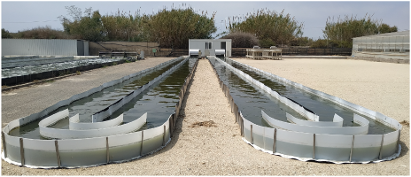

# Concurso en Ingeniería de Control 2027 (CIC2027)

### Control de un reactor *raceway* para la producción de biomasa de microalgas

**Benchmark de identificación, control y optimización de procesos**

[📄 Bases del concurso](doc/CIC2027_Bases.pdf) · [📘 Descripción del benchmark](doc/CIC2027_Descripcio%CC%81n.pdf)

---

## Presentación

El **Concurso en Ingeniería de Control 2027 (CIC2027)**, organizado por el **Grupo Temático de Ingeniería de Control del Comité Español de Automática (CEA)** junto con el grupo de **Automática, Robótica y Mecatrónica** de la **Universidad de Almería**, propone un benchmark basado en la operación de un reactor abierto tipo *raceway* destinado al cultivo de microalgas.

  
  
<em>Reactores raceway para la producción de biomasa de microalgas.</em>

El objetivo es que equipos de estudiantes diseñen y evalúen estrategias de control para regular las principales variables del proceso y, en su caso, mejorar la productividad de biomasa respetando las restricciones de operación. El benchmark también constituye un recurso docente para asignaturas de identificación, control y optimización de procesos.

## Categorías del concurso

| Categoría | Objetivo | Material |
|:--|:--|:--|
| **C1 — Control PID de la planta** | Regulación de **pH, oxígeno disuelto y temperatura**, con cosechado y dilución fijos. Orientada a estudiantes de grado. | [Acceder a C1](CIC2027_C1/) |
| **C2 — Control y operación eficiente** | Además de los lazos de C1, gestión del **cosechado y la dilución** para mejorar la productividad de biomasa bajo restricciones. Orientada a estudiantes de máster y doctorado. | [Acceder a C2](CIC2027_C2/) |

## Archivos y carpetas

GitHub muestra automáticamente el listado actualizado de archivos y carpetas encima de este README. Los siguientes enlaces permiten acceder directamente al material:

| Carpeta / archivo | Contenido |
|:--|:--|
| 📁 [CIC2027_C1/](CIC2027_C1/) | Código MATLAB, datos del benchmark, controladores y ejemplos para la categoría 1 [Descargar](https://downgit.github.io/#/home?url=https://github.com/guzmanjl/benchmarkmicroalgae/tree/main/CEA/CIC2027_C1). |
| 📁 [CIC2027_C2/](CIC2027_C2/) | Código MATLAB, datos del benchmark, controladores y ejemplos para la categoría 2 [Descargar](https://downgit.github.io/#/home?url=https://github.com/guzmanjl/benchmarkmicroalgae/tree/main/CEA/CIC2027_C2). |
| 📁 [doc/](doc/) | Documentación oficial del concurso en PDF. |
| 📄 `README.md` | Esta página de presentación. |

Las dos carpetas de categoría incluyen un archivo principal [**`Benchmark_main.m` (C1)**](CIC2027_C1/Benchmark_main.m) o [**`Benchmark_main.m` (C2)**](CIC2027_C2/Benchmark_main.m), datos `.mat`, archivos de controladores `.m` y las subcarpetas [`ejemplos_PI/`](CIC2027_C1/ejemplos_PI/) y [`sources/`](CIC2027_C1/sources/). La categoría C2 incorpora además [`controller_HD.m`](CIC2027_C2/controller_HD.m) para la gestión de cosechado y dilución.

## Documentación oficial

- **[Bases del CIC2027](doc/CIC2027_Bases.pdf)**: objetivos, participantes, categorías, inscripción, fases y condiciones del concurso.
- **[Descripción del concurso y del benchmark](doc/CIC2027_Descripcio%CC%81n.pdf)**: descripción técnica del problema de control y del entorno de evaluación.

Se recomienda leer **ambos documentos** antes de desarrollar una propuesta. Las bases oficiales prevalecen sobre este resumen.

## Organización

**Grupo Temático de Ingeniería de Control — Comité Español de Automática (CEA)**  
**Grupo de Automática, Robótica y Mecatrónica (ARM, TEP-197), Universidad de Almería / CIESOL**.

[Web del Grupo Temático de Ingeniería de Control](https://www.ceautomatica.es/es/grupos/ingenieria-de-control)
